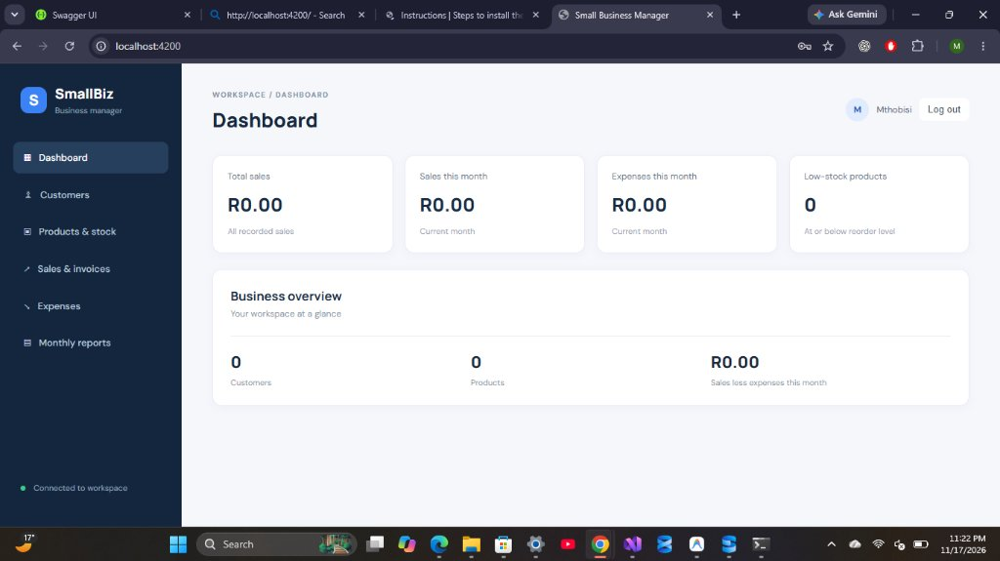
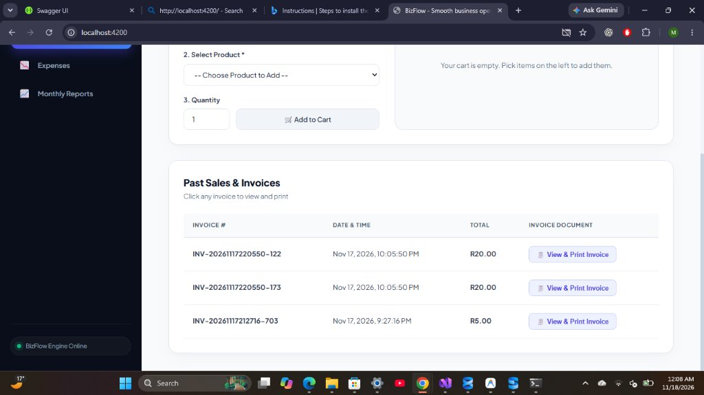
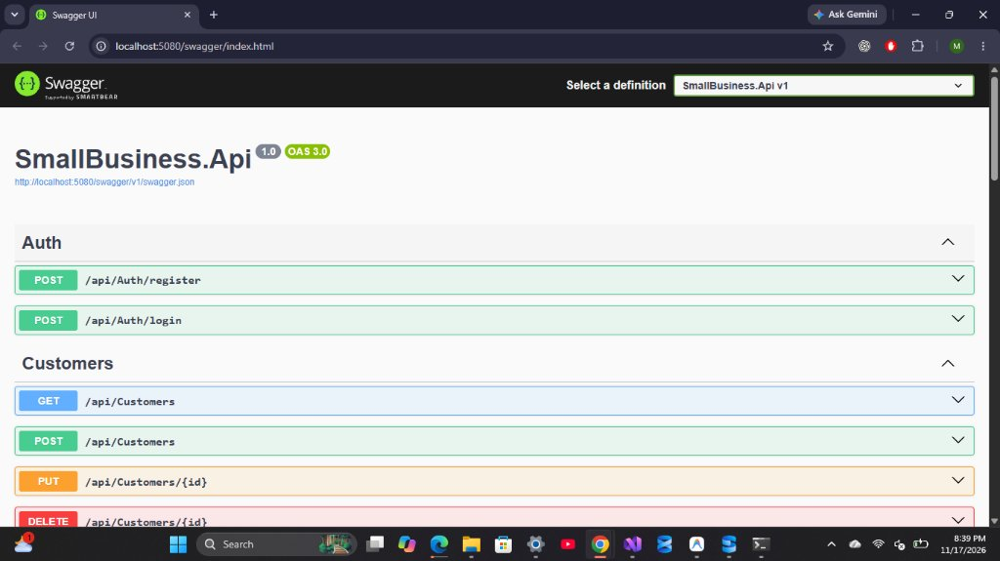

# BizFlow — Smooth Business Operations (Full-Stack)


A modern full-stack business management and Point of Sale (POS) system engineered to help small businesses track daily operations, inventory levels, sales, expenses, and automated customer invoicing.

---

## 📸 Application Screenshots

### 1. Executive Dashboard (Live KPIs, Monthly Margins & Sales Trends)


### 2. Point of Sale (POS) Checkout & Invoice Ledger


### 3. Backend ASP.NET Core Web API (Swagger UI & REST Endpoints)


---

## 🌟 Key Features

1. **User Authentication & Multi-Tenant Data Isolation**
   - Secure registration and login using stateless **JWT (JSON Web Tokens)**.
   - Passwords cryptographically hashed using **BCrypt** (never stored in plain text).
   - Strict multi-tenant data scoping: all queries and records are scoped to the authenticated `UserId`.

2. **Point of Sale (POS) & Automated Inventory Management**
   - Interactive multi-item shopping cart with instant `+` and `-` quantity adjusters.
   - Real-time stock availability check prevents overselling.
   - Atomic database transactions: selling an item safely decrements stock; voiding/deleting an invoice automatically restores stock to inventory.
   - Low-stock threshold alerts with color-coded warning badges.

3. **Customer Relationship Management (CRM)**
   - Complete client directory with instant live search filtering.
   - Quick contact action buttons (direct `mailto:` and `tel:` links).

4. **Invoicing & Expense Tracking**
   - Automatic unique invoice number generation (`INV-YYYYMMDDHHMMSS-XXX`).
   - One-click **Print / Save as PDF** branded digital invoices.
   - Operating expense logging across categorized business overheads (Rent, Utilities, Wages, Supplies, Marketing).

5. **Financial Reports & Data Exports**
   - 12-Month sales comparison bar charts for annual performance review.
   - One-click **Export to CSV** for Customer lists, Inventory catalogs, and Monthly Sales reports.

---

## 🛠️ Technology Stack

| Layer | Technology |
|---|---|
| **Frontend** | Angular 18 (Standalone Components, Reactive Forms, CSS3 Luxury Theme) |
| **Backend** | ASP.NET Core 8 Web API (C#) |
| **Database** | Microsoft SQL Server / LocalDB (`MSSQLLocalDB`) |
| **ORM** | Entity Framework Core (Code-First with automatic schema generation) |
| **Authentication** | JWT Bearer Tokens + BCrypt.Net-Next |
| **Documentation** | Swagger / OpenAPI UI |
| **Version Control** | Git & GitHub |
| **Cloud Ready** | Microsoft Azure (App Service, Azure SQL, Static Web Apps) |

---

## 🚀 Getting Started

### Prerequisites
- [.NET 8+ SDK](https://dotnet.microsoft.com/)
- [Node.js 20+ LTS](https://nodejs.org/)
- Microsoft SQL Server or SQL Server LocalDB (installed with Visual Studio)

### 1. Open and Run the Backend API
1. Double-click **`SmallBusinessManagementSystem.sln`** to open in Visual Studio 2022.
2. In Solution Explorer, ensure **`SmallBusiness.Api`** is set as the Startup Project.
3. Press **F5** (or click the green **Play** button).
   - The API will start on `http://localhost:5080`.
   - The database and tables will be created automatically in SQL Server LocalDB.
   - Swagger documentation is available at `http://localhost:5080/swagger`.

### 2. Run the Angular Frontend
1. Open a terminal in `frontend/small-business-ui`:
   ```bash
   npm install
   npm start
   ```
2. Navigate to **`http://localhost:4200`** in your browser.
3. Click **Create Account** to register your business owner credentials and log in!

---

## 📁 Repository Structure

```
SmallBusinessManagementSystem/
├── assets/                               # Embedded UI & Swagger screenshots
│   ├── dashboard.jpg
│   ├── pos-invoices.jpg
│   └── swagger-api.jpg
│
├── SmallBusinessManagementSystem.sln     # Root Visual Studio solution
├── README.md                             # Project documentation
│
├── backend/
│   ├── SmallBusiness.sln                 # Backend solution file
│   └── SmallBusiness.Api/                # ASP.NET Core 8 Web API
│       ├── Controllers/                  # Auth, Customers, Products, Sales, Expenses, Reports
│       ├── Data/                         # EF Core DbContext & relationship mappings
│       ├── Models/                       # Domain entities
│       ├── DTOs/                         # Request & Response transfer records
│       ├── appsettings.json              # Connection strings & JWT secret
│       └── Program.cs                    # Dependency injection & pipeline configuration
│
└── frontend/
    └── small-business-ui/                # Angular 18 Standalone Single Page Application
        └── src/app/
            ├── api.service.ts            # Typed HTTP client service
            ├── auth.interceptor.ts       # Automatic JWT token bearer injection
            └── app.component.ts          # Comprehensive multi-view dashboard & POS UI
```

---

## ☁️ Azure Deployment Outline
1. **Azure SQL Database:** Create a serverless Azure SQL database and configure firewall rules.
2. **Azure App Service (Backend):** Deploy `SmallBusiness.Api` directly from Visual Studio. Set `ConnectionStrings__DefaultConnection` and `Jwt__Key` in App Service Configuration.
3. **Azure Static Web Apps (Frontend):** Run `npm run build` and deploy `dist/small-business-ui/browser`.
4. Configure CORS to allow your deployed frontend domain.

---

## 📄 License
This project is open-source and available under the [MIT License](LICENSE).
